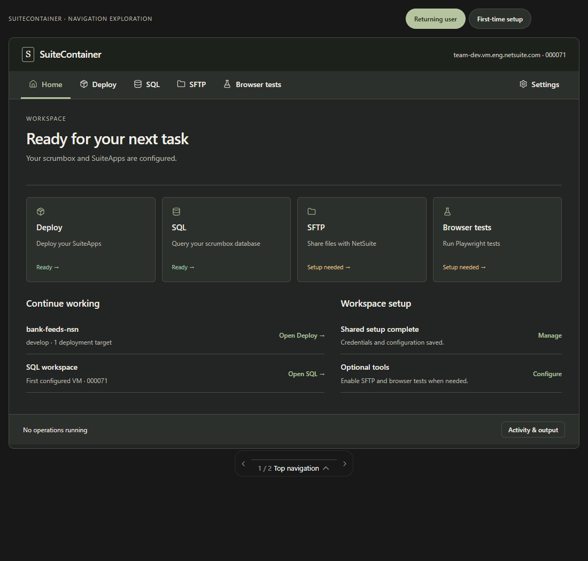

# SuiteContainer initial workspace visualization handoff

Use the initial **Top navigation** concept as the reference for the full SuiteContainer workspace experience. It combines a guided first-time setup with a tool-focused Home screen for returning users.

This handoff records the earlier concept identified by the user's setup screenshot. It is separate from the later, smaller UI update with reordered credential sections and repeatable SuiteApp blocks. Creating this handoff does not implement either design in the application.

## Reference files

- [Complete visualization image](references/initial-visualization/workspace-overview.png)
- [Interactive preview](references/initial-visualization/preview.html)
- [Original visualization fragment](references/initial-visualization/prototype.html)

The image below is a fresh full-page capture of the returning-user Home screen. The user's clipped image was used only to identify the concept and was not saved.

Open the interactive preview to explore the setup flow. Select **Top navigation**, then **First-time setup**. Advance from Scrumbox to Credentials and choose **Use sample credentials** to reproduce the state shown in the user's reference.

The original fragment contains both Top navigation and Tool launcher alternatives. This handoff concerns Top navigation.

## Application layout

- Keep SuiteContainer branding and scrumbox domain and account context in the header.
- Use a horizontal navigation row with **Home, Deploy, SQL, SFTP, Browser tests**, and **Settings**. Keep Settings at the right on desktop.
- Place the selected tool or setup step in a central workspace with room for its fields, actions, and output.
- Use the footer for setup progress or operation status and access to activity output.
- Keep the same navigation locations for new and returning users. Reflow controls at narrow widths.
- Follow the restrained NetSuite Next and Redwood-inspired appearance shown in the image: dark neutral surfaces, muted green emphasis, readable type, and modest borders. The concept is an interpretation rather than an exact NetSuite Next reproduction.

The user rejected a persistent sidebar and a bottom navigation dock.

## First-time setup

The initial concept uses five steps:

| Step | Content and behavior |
| --- | --- |
| 1. Scrumbox | Enter the domain without `https://` and the NetSuite account ID. Explain that SQL and SFTP use the first configured VM. |
| 2. Credentials | Configure GitLab access when cloning repositories. Generate or locate certificates, register the public certificate in NetSuite OAuth 2.0 Client Credentials M2M Setup, and save the assigned certificate ID. |
| 3. SuiteApps | Configure the SuiteApp and branch. The original prototype shows a directory field, a source choice, and a repository URL. |
| 4. Optional tools | Offer SFTP and browser-test configuration with an explicit skip action. SQL credentials are requested when using SQL. |
| 5. Review | Summarize the scrumbox, SuiteApp, and credentials before opening Home. Completing setup must not start deployment. |

Provide Back and Save and continue actions. Display the current step and progress in the footer. Offer Save and return later and access to the setup flow through Settings.

In this prototype, credential registration is simulated by a sample button. Production implementation needs the existing real credential controls and backend validation. The preview's saved state is illustrative and does not define production persistence.

## Returning users and tool pages

Open Home after shared setup is complete. Show shortcuts for Deploy, SQL, SFTP, and Browser tests with clear Ready or Setup needed labels. Include links to continue deployment or SQL work and manage shared setup.

Each tool should keep its inputs, actions, and results together. Keep an operation's status available when users navigate elsewhere. Give activity output a consistent location. Require an explicit action to deploy or run a tool.

Keep deployment targets distinct from the first configured VM used by SQL and SFTP. Retain advanced JSON access in Settings alongside ordinary configuration fields.

## Implementation boundaries

The user's current request is for a handoff file. Treat the prototype as a design reference rather than a production implementation or authorization to start coding.

When implementation is assigned:

- Inspect the active branch and working tree and follow applicable AGENTS.md instructions.
- Start by inspecting the UI entry point previously located at `app/src/web-page.ts` and the API behavior in `app/src/web-server.ts`.
- Preserve existing configuration, credentials, validation, operation locks, output redaction, and local-checkout support.
- Determine which tools exist on the target branch before wiring the navigation. Browser tests appears in the concept and does not establish backend availability.
- Keep preview controls, sample credentials, demonstration actions, and illustrative data out of the product.
- Resolve later UI refinements with the user before combining them with this initial design.

The longer-term backend goal is equal support for fully native and container execution. That work is separate from this visual handoff.

## Acceptance checks for future implementation

- New users can complete required shared setup and skip optional tools.
- Back navigation and saving progress preserve entered configuration.
- Completing setup opens Home without deploying.
- Returning users can locate each supported tool without scrolling through configuration.
- Tool state and output remain accessible during navigation.
- Keyboard navigation and narrow-screen layouts remain usable.
- Use only existing checks relevant to the implemented change and one focused browser walkthrough. Follow the repository's limits on tests and retries.

No application tests are needed for this documentation-only handoff.
