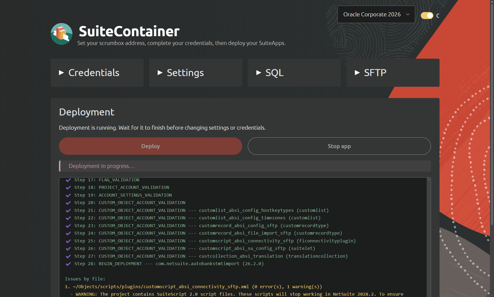

# SuiteContainer quickstart

Deploy NetSuite SuiteApps through a browser interface backed by Podman and the SuiteCloud CLI.

1. Run the launcher for your platform:

   | Platform | Launcher |
   | --- | --- |
   | Windows | Double-click `start/start-windows.cmd` |
   | macOS | Open `start/start-macos.command` |
   | Codebox | Run `bash start/start-codebox` |

2. Open the deployment page. For a remote codebox, follow the port-forwarding instructions printed by the launcher.
3. Complete **Setup** with your VM, certificates, and GitLab token if needed, then click **Save credentials**.
4. Add your repositories and branches under **SuiteApps**, then click **Save SuiteApps**. Use **Advanced configuration** for local checkouts or additional targets.
5. Click **Deploy SuiteApps** and review the output.

The launcher prepares Podman and the app. Starting it does not deploy anything. Use **Stop app** when deployment and SQL are idle. Run the launcher again to reopen it.

See the [detailed instructions](app/docs/USERMANUAL.md) for certificate registration, configuration examples, local checkouts, tools, and troubleshooting.
